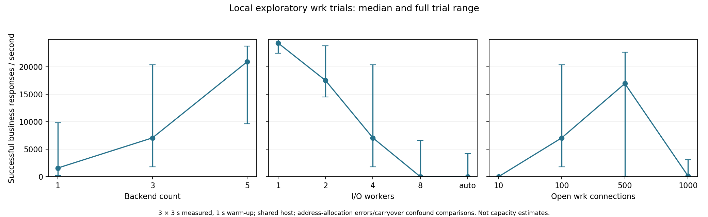

# Local exploratory benchmark results

These retained measurements provide context for the benchmark tooling. They are
short, closed-loop tests on a shared macOS arm64 host reporting 10 logical CPUs:
three trials per case, three seconds measured after one second of warm-up, two
wrk threads, and a five-second cooldown. Application logging and one-second
Prometheus scraping were enabled. They are **not production capacity estimates**.

| Case | HTTP RPS median [min, max] | Successful RPS median | p95 / p99 ms | Median HTTP failure fraction |
|---|---:|---:|---:|---:|
| direct | 36144.4 [36075.9, 36388.5] | 36144.4 | 3.834 / 5.963 | 0.0000 |
| proxy-1b-4w | 15985.8 [9834.7, 39340.2] | 1577.0 | 390.517 / 649.758 | 0.9014 |
| proxy-3b-4w | 20367.6 [12986.2, 24581.8] | 7064.5 | 470.151 / 616.800 | 0.7126 |
| proxy-5b-4w | 23749.1 [20906.1, 39620.1] | 20906.1 | 9.955 / 56.438 | 0.0000 |
| workers-1 | 24297.5 [22459.2, 25119.1] | 24297.5 | 8.093 / 43.703 | 0.0000 |
| workers-2 | 17502.1 [14478.6, 23807.2] | 17493.4 | 63.683 / 194.948 | 0.0005 |
| workers-8 | 19273.8 [5436.9, 32885.3] | 14.6 | 861.398 / 1191.455 | 0.9979 |
| workers-0 | 28701.9 [21694.1, 35418.2] | 14.2 | 499.162 / 876.822 | 0.9995 |
| connections-10 | 55875.0 [35498.4, 66133.9] | 8.3 | 21.520 / 37.498 | 0.9998 |
| connections-500 | 22621.1 [16789.3, 27548.2] | 16933.4 | 49.688 / 115.883 | 0.3853 |
| connections-1000 | 3182.9 [198.0, 11558.8] | 135.0 | 1393.051 / 2033.636 | 0.3179 |
| quiescent-probes | 20700.5 [19956.5, 26923.8] | 20697.2 | 14.618 / 152.109 | 0.0002 |
| controlled-crash | 27358.5 [26650.5, 27506.7] | 24573.4 | 14.782 / 114.594 | 0.0779 |

## Interpretation

The direct-backend trials were error-free. Several proxied trials were dominated
by 502/503/504 responses, and address allocation failed during earlier workload
and monitoring attempts. TCP/address-resource pressure is a candidate explanation;
the exact kernel cause was not established because host-wide inspection was
restricted. Cooldown and randomized order did not eliminate carryover.

High total HTTP RPS can reflect fast error responses. Successful business RPS
counts validated HTTP 200 responses; latency includes error responses. These
samples do not isolate normal proxy overhead or establish reliable worker-scaling
benefits. Fresh upstream connections and synchronized per-request logging warrant
profiling on separate load-generator/server hosts with longer trials.

## Data Source

- [Per-trial measurements and process resource statistics](benchmarks/trials.csv)
- [Statistical summary](benchmarks/summary.json)
- [Workload, binary hashes, platform, and shuffled schedule](benchmarks/metadata.json)

CPU figures in the CSV cover process lifetimes, including warm-up/collection;
RSS is peak resident memory. Host-wide CPU/network telemetry was unavailable.
The metadata identifies the historical binary revision and dirty worktree; it
does not describe the current source checkout. Older raw logs and development
progress reports are not part of the maintained source distribution.

See [benchmark instructions](../benchmarks/README.md) to reproduce measurements
and generate fresh raw output, metrics, and Grafana snapshots under `build/`.
